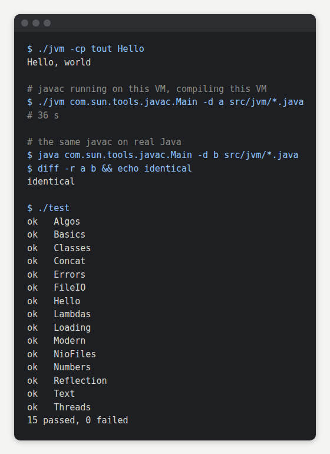

# jvm

A Java Virtual Machine written from scratch in Java. It reads class files, interprets the bytecode and runs the real JDK 17 class library on top, module system included. It is complete enough to run `javac`: the Java compiler, running on this VM, compiles this VM's own source to exactly the same class files as on real Java.

```
./build
./jvm -cp classes Main arg1 arg2
./test
```

Building needs JDK 17 or newer. Programs run against the JDK 17 class library, found through `JVM_JDK` (default `/usr/lib/jvm/java-17-openjdk-amd64`). Linux only.

<picture>
  <source media="(min-width: 768px)" srcset="demo/wide.png">
  
</picture>

## What works

Each program in `tests/` must print exactly what real Java prints and exit with the same code. Together they cover lambdas and streams, records and sealed types, threads, locks and `wait`/`notify`, reflection, annotations and proxies, exceptions and stack traces, `java.io` and `java.nio.file`, jars and custom class loaders, serialization, `BigInteger`, regex, `java.time`, other locales and charsets.

## How it works

- `Klass` parses the class file, lays out fields and builds the vtable.
- `Interp` is one switch over the bytecode. Each thread keeps its operand stacks and locals in two arrays, one for primitives and one for references.
- The JDK's native methods, a few hundred of them, are rewritten in Java in `Natives`, `Unsafe`, `Reflect`, `IO`, `Nio`, `Threads`, `Loaders` and `Invoke`.
- `invokedynamic` and method handles go through the JDK's own `java.lang.invoke` code. The VM provides what HotSpot provides: member name resolution, `invokeBasic`, `linkTo*` and hidden classes.
- Boot follows the same steps as HotSpot: `initPhase1`, then the module system, then the system class loader. Application classes are loaded by the JDK's own class loader.
- Guest objects are host objects, so garbage collection is done by the host JVM. Guest threads are host threads.

## Speed

Measured on a 2-core Haswell VPS.

| | this VM | real Java |
|---|---|---|
| Hello world | 0.6 s | 0.05 s |
| javac compiling this VM | 36 s | 3.6 s |
| tight loop, warmed up | 24 ns per bytecode | 1.7 ns with `-Xint` |

Long-running programs go about twice as fast with `JVM_OPTS="-XX:TieredStopAtLevel=4 -XX:PerMethodTrapLimit=0"`, at the cost of a slower start.

## Limits

- Interpreter only, no JIT.
- No bytecode verifier.
- Weak and soft references are never cleared and finalizers never run.
- No networking, no child processes, no JNI libraries, no GUI.

## Todo

- [ ] Sockets
- [ ] Faster interpreter
- [ ] JDK 21 class library
